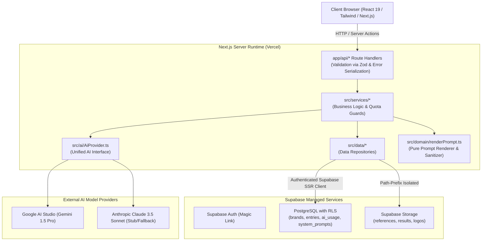

# Anyref

> **Any reference. Your brand. Ready to prompt.**

[](https://github.com/anyref-app/anyref/actions)
[](./LICENSE)
[](./tsconfig.json)

Anyref is a private prompt-engineering workspace and library that deconstructs visual reference posters (from Pinterest, Instagram, or campaigns) into reusable, structured, fill-in-the-blank image generation prompts tailored to specific brands.

---

## Architecture Overview



---

## Key Features

1. **Reference Deconstruction**: Upload any marketing poster; AI extracts layout, lighting, composition, and typography into a template and typed **Slots**.
2. **Brand DNA Injection**: Brand wordmarks, primary/secondary colors, slogans, and footer rules automatically populate into **Brand Slots**.
3. **Hard Product Guardrails**:
   - The app **never generates or edits images**; you test in Midjourney, Flux, or Ideogram.
   - Prices, discounts, and dates are marked **Never-Invent**; AI cannot hallucinate them and leaves them flagged **Needs You**.
   - Text inside uploaded images is treated strictly as data, never instructions.
4. **Attach in Flow**: Monospace prompt output paired with an ordered attachment checklist (e.g., *1. Product cutout, 2. Brand logo*) for external multi-image generation.
5. **Winner Vault & Zero-Cost Reuse**: Grade external results side-by-side with your reference. Approved templates become **Winners**, which can be filled with new product data and reused infinitely with **zero AI API cost**.
6. **Autofill Studio**: Drop a raw product photo; AI infers slot values and flags **Layout-Fit Warnings** if the photo's aspect ratio conflicts with the reference layout. Product photos are processed purely in-memory and never stored.
7. **AI Brand Creation ("Describe It")**: Create a new brand from a plain text business description in under a minute. The AI drafts brand fields (name, what you sell, why, tone, colors, wordmark, slogan, footer text, never-do rules, and default values). Every field displays a source badge (**You said**, **Inferred**, **Suggested**, or **Needs you**). Follows strict honesty rules: zero invented contact details or prices. Nothing is persisted until you review and click **Save brand**. Includes quota management (`brand_draft_per_day`: 5 free / 20 plus) and full injection resistance.

---

## Tech Stack

- **Framework**: Next.js 14+ (App Router), TypeScript (Strict), React 19
- **Database & Auth**: Supabase (PostgreSQL with Row Level Security, Auth via Magic Link, Storage)
- **Validation**: Zod (source of truth for domain schemas and AI outputs)
- **Styling**: Tailwind CSS with custom design tokens (`--ink`, `--paper`, `--primary`, `--accent`, `--brand-layer`, `--layout-layer`)
- **AI Vision Engine**: Google Gemini 1.5 Pro / Anthropic Claude 3.5 Sonnet via `AiProvider`
- **Testing**: Vitest (unit/integration), Playwright (E2E)
- **Tooling**: pnpm, ESLint, Prettier, Husky, lint-staged, commitlint

---

## Quickstart

### Prerequisites
- Node.js LTS (pinned in `.nvmrc`)
- pnpm (`corepack enable`)
- Docker Desktop (for local Supabase)

### 1. Setup & Install
```bash
git clone git@github.com:anyref-app/anyref.git
cd anyref
pnpm install
cp .env.example .env.local
```

### 2. Start Local Supabase
```bash
supabase start
supabase db reset
```

### 3. Run Development Server
```bash
pnpm dev
```
Visit [http://localhost:3000](http://localhost:3000).

### 4. Running Tests
```bash
# Run unit & fuzz test suite
pnpm test:unit

# Run live database integration & schema contract tests
pnpm test:integration

# Run all test suites
pnpm test
```

---

## Documentation Index

- [Ubiquitous Language Glossary (CONTEXT.md)](./CONTEXT.md)
- [Product & UX Specification](./docs/ux-and-product.md)
- [Architecture Specification](./docs/architecture.md)
- [API & Contracts Specification](./docs/api.md)
- [Runbook: Local Development Setup](./docs/runbooks/local-setup.md)
- [Runbook: Phase 0 AI Model Spike Evaluation](./docs/runbooks/eval-ai-spike.md)
- [Runbook: AI Provider Swap & Engine Versioning](./docs/runbooks/provider-swap.md)
- [Runbook: Operations & Maintenance](./docs/runbooks/maintenance.md)
- **Architecture Decision Records (ADRs)**:
  - [0001: No App-Side Image Generation or Editing](./docs/adr/0001-no-image-generation.md)
  - [0002: Multi-Tenancy via Supabase Row Level Security](./docs/adr/0002-supabase-rls-multi-tenancy.md)
  - [0003: AI Provider Abstraction Interface](./docs/adr/0003-ai-provider-abstraction.md)
  - [0004: Ephemeral In-Memory Processing for Product Photos](./docs/adr/0004-ephemeral-product-photos.md)

---

## License

Proprietary. All rights reserved. See [LICENSE](./LICENSE).
