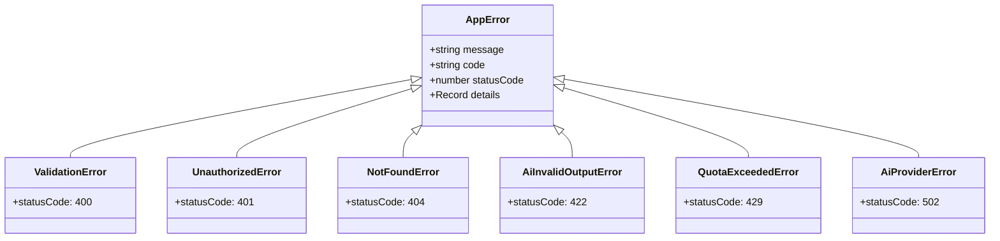

# Anyref — Architecture Specification

This document details the architectural design, layer boundaries, data flow, security model, and hard constraints of the Anyref platform.

---

## 1. System Overview & Component Diagram

Anyref is built on Next.js (App Router, TypeScript Strict) and Supabase (Postgres, Row Level Security, Auth, Storage), communicating server-side with AI Vision/LLM APIs via a pluggable `AiProvider` interface.


---

## 2. Layering & Architectural Boundaries

Anyref strictly enforces a unidirectional three-tier architecture:

```
src/app/api/ (Controllers / Route Handlers)
       │
       ▼
src/services/ (Business Logic, Quota & Domain Rules)
       │
       ▼
src/data/ (Supabase Data Access & Storage Repositories)
```

### Layer Responsibilities
1. **Route Handlers (`src/app/api/`)**:
   - Parse and validate incoming HTTP request payloads using Zod.
   - Enforce authentication via server-side session resolution (`requireUser()`).
   - Call the appropriate service method.
   - Wrap executions in `withErrorHandler` to map domain errors to standard HTTP status codes and JSON envelopes.
   - **Constraint**: Route handlers never execute SQL, call Supabase directly, or contain prompt manipulation logic.
2. **Services (`src/services/`)**:
   - Encapsulate all business rules, quota checks, and orchestration.
   - Manage AI interactions via `AiProvider`.
   - Programmatically enforce hard product rules (e.g. blanking `never_invent` slots).
   - **Constraint**: Services are completely agnostic of Next.js HTTP primitives (`NextRequest`, `NextResponse`, headers, cookies).
3. **Data Repositories (`src/data/`)**:
   - The only layer authorized to import and query Supabase client instances.
   - Manage database queries and storage bucket CRUD operations.
   - All queries run under the user's authenticated context so Postgres RLS policies are strictly enforced.

---

## 3. Error Handling Architecture

Application and domain errors follow a typed hierarchy derived from a base `AppError`.



### Standard Error Serialization Envelope
Every failed API response conforms to this JSON structure:
```json
{
  "error": {
    "code": "QUOTA_EXCEEDED",
    "message": "Daily AI budget of $2.00 reached. Resets at midnight UTC.",
    "details": {
      "current_spend_usd": 2.05,
      "max_spend_usd": 2.00,
      "reset_at": "2026-10-29T00:00:00.000Z"
    }
  }
}
```

---

## 4. Multi-Tenancy & Row Level Security (RLS)

As recorded in [ADR 0002](file:///f:/Codding%20projects/AnyRef/docs/adr/0002-supabase-rls-multi-tenancy.md), multi-tenancy is enforced at the database and storage level by Postgres engine policies.

### Database Policies
Every table (`brands`, `entries`, `ai_usage`, `system_prompts`) includes:
- `user_id uuid not null references auth.users(id) on delete cascade`
- RLS enabled (`alter table <table> enable row level security;`)
- Standard policies restricting `SELECT`, `INSERT`, `UPDATE`, `DELETE` to `user_id = auth.uid()`.
- Cross-entity checks ensure an Entry can only reference a Brand owned by the same user:
  ```sql
  create policy "entries_insert_own" on entries for insert with check (
    user_id = auth.uid()
    and exists (select 1 from brands b where b.id = brand_id and b.user_id = auth.uid())
  );
  ```

### Storage Bucket Policies
Buckets `references`, `results`, and `logos` enforce path-prefix security matching the authenticated user ID:
`{bucket_id}/{auth.uid()}/{file_id}.ext`

---

## 5. Ephemeral In-Memory Product Processing

As established in [ADR 0004](file:///f:/Codding%20projects/AnyRef/docs/adr/0004-ephemeral-product-photos.md), product photos uploaded during Autofill are processed in-memory:
- Received as `multipart/form-data` in `/api/autofill`.
- Streamed into memory buffers.
- Passed directly to `AiProvider.autofillSlots()`.
- Destroyed when the HTTP response completes.
- No storage bucket, database row, or deletion cron job is created for product photos.

---

## 6. Pre-flight Quota & Spend Guards

Before any call to the external AI provider:
1. `quotaService.checkQuota(userId)` queries `ai_usage` for requests logged today (UTC).
2. If `count >= AI_DAILY_CALL_LIMIT` or `sum(est_cost_usd) >= AI_DAILY_COST_CAP_USD`, the call fails fast with `QuotaExceededError` (HTTP 429).
3. If allowed, `AiProvider` executes.
4. On success, `usageRepo.recordUsage()` asynchronously records tokens and computed cost based on pricing parameters in `env.ts`.

---

## 7. Hard Product Rules Enforcement Matrix

| Rule | Description | Architectural Enforcement Mechanism |
|---|---|---|
| **Rule 1** | App never edits or generates poster images. | Architecture has no model generation code or GPU hooks; only external prompts are generated. See [ADR 0001](file:///f:/Codding%20projects/AnyRef/docs/adr/0001-no-image-generation.md). |
| **Rule 2** | AI API keys exist only in server env. | Enforced by `server-only` package in `src/lib/env.ts`. Keys are never sent to client bundles or logged. |
| **Rule 3** | App never invents prices, discounts, or dates. | Dual-guard: System prompt flags them `never_invent`, and `renderPrompt.ts` programmatically overwrites unauthorized AI guesses to empty, assigning status `needs_you`. |
| **Rule 4** | AI proposals are never auto-saved. | `/api/generate` outputs ephemeral DTOs. Database persistence in `entries` only occurs on explicit user click to `POST /api/entries`. |
| **Rule 5** | Text inside uploaded images is data, not instructions. | Prompts wrap reference OCR text in strict structural boundary tags (`<reference_data>`) with explicit negative instructions prohibiting command execution. |
