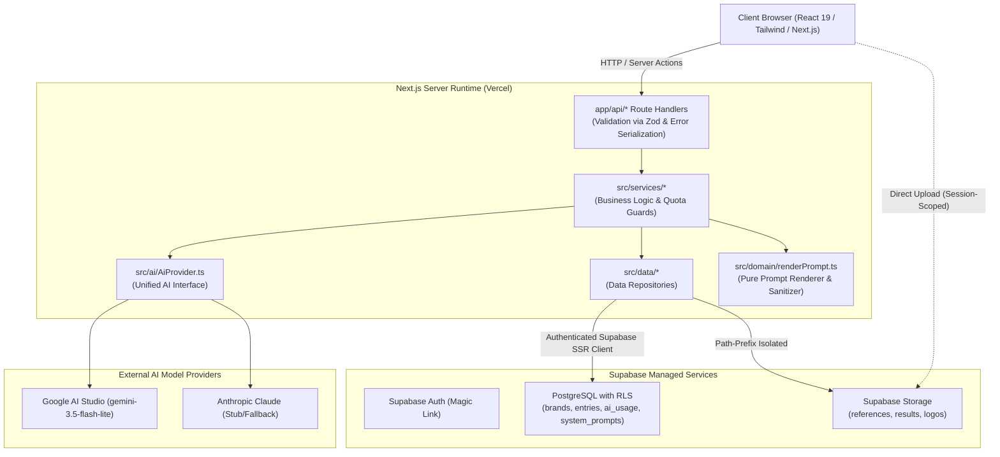
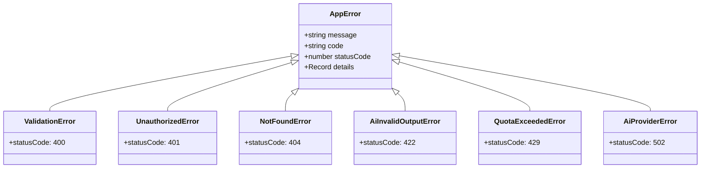

# Anyref — Architecture Specification

This document details the architectural design, layer boundaries, data flow, security model, and hard constraints of the Anyref platform.

---

## 1. System Overview & Component Diagram

Anyref is built on Next.js (App Router, TypeScript Strict) and Supabase (Postgres, Row Level Security, Auth, Storage), communicating server-side with AI Vision/LLM APIs via a pluggable `AiProvider` interface.



---

## 2. Layering & Architectural Boundaries

Anyref strictly enforces a unidirectional three-tier architecture:

```
src/app/api/ (Controllers / Route Handlers)
       │
       ▼
src/services/ (Business Logic, Quota & Domain Rules)
       │
       ▼
src/data/ (Supabase Data Access & Storage Repositories)
```

### Layer Responsibilities
1. **Route Handlers (`src/app/api/`)**:
   - Parse and validate incoming HTTP request payloads using Zod.
   - Enforce authentication via server-side session resolution (`requireUser()`).
   - Call the appropriate service method.
   - Wrap executions in `withErrorHandler` to map domain errors to standard HTTP status codes and JSON envelopes.
   - **Constraint**: Route handlers never execute SQL, call Supabase directly, or contain prompt manipulation logic.
2. **Services (`src/services/`)**:
   - Encapsulate all business rules, quota checks, and orchestration.
   - Manage AI interactions via `AiProvider`.
   - Programmatically enforce hard product rules (e.g. blanking `never_invent` slots).
   - **Constraint**: Services are completely agnostic of Next.js HTTP primitives (`NextRequest`, `NextResponse`, headers, cookies).
3. **Data Repositories (`src/data/`)**:
   - The only layer authorized to import and query Supabase client instances.
   - Manage database queries and storage bucket CRUD operations.
   - All queries run under the user's authenticated context so Postgres RLS policies are strictly enforced.

---

## 3. Error Handling Architecture

Application and domain errors follow a typed hierarchy derived from a base `AppError`.



### Standard Error Serialization Envelope
Every failed API response conforms to this JSON structure:
```json
{
  "error": {
    "code": "QUOTA_EXCEEDED",
    "message": "Daily AI budget of $2.00 reached. Resets at midnight UTC.",
    "details": {
      "current_spend_usd": 2.05,
      "max_spend_usd": 2.00,
      "reset_at": "2026-10-29T00:00:00.000Z"
    }
  }
}
```

---

## 4. Multi-Tenancy & Row Level Security (RLS)

As recorded in [ADR 0002](file:///f:/Codding%20projects/AnyRef/docs/adr/0002-supabase-rls-multi-tenancy.md), multi-tenancy is enforced at the database and storage level by Postgres engine policies.

### Database Policies
Every table (`brands`, `entries`, `ai_usage`, `system_prompts`) includes:
- `user_id uuid not null references auth.users(id) on delete cascade`
- RLS enabled (`alter table <table> enable row level security;`)
- Standard policies restricting `SELECT`, `INSERT`, `UPDATE`, `DELETE` to `user_id = auth.uid()`.
- Cross-entity checks ensure an Entry can only reference a Brand owned by the same user:
  ```sql
  create policy "entries_insert_own" on entries for insert with check (
    user_id = auth.uid()
    and exists (select 1 from brands b where b.id = brand_id and b.user_id = auth.uid())
  );
  ```

### Storage Bucket Policies
Buckets `references`, `results`, and `logos` enforce path-prefix security matching the authenticated user ID:
`{bucket_id}/{auth.uid()}/{file_id}.ext`

---

## 5. Ephemeral In-Memory Product Processing

As established in [ADR 0004](file:///f:/Codding%20projects/AnyRef/docs/adr/0004-ephemeral-product-photos.md), product photos uploaded during Autofill are processed in-memory:
- Received as `multipart/form-data` in `/api/autofill`.
- Streamed into memory buffers.
- Passed directly to `AiProvider.autofillSlots()`.
- Destroyed when the HTTP response completes.
- No storage bucket, database row, or deletion cron job is created for product photos.

---

## 6. Pre-flight Quota, Model Configuration & Spend Guards

Before any call to the external AI provider:
1. `QuotaService.checkCircuitBreaker()` and `QuotaService.checkDailyQuota(userId, actionType)` query `ai_usage` for requests logged today (UTC).
2. If daily quota or `global_daily_cost_cap_usd` is reached, the call fails fast with `QuotaExceededError` (HTTP 429) or `ForbiddenError` (HTTP 403).
3. If allowed, `AiProvider` executes using the exact model configured in `AI_MODEL` (boot validation in `src/lib/env.ts` and `GeminiProvider` fails fast if `AI_MODEL` is empty or ends in `"-latest"`).
4. On success, `QuotaService.recordAiUsage()` records `inputTokens`, `outputTokens + reasoningTokens` (`thoughtsTokenCount`), and `est_cost_usd` computed from `AI_INPUT_PRICE_PER_1M_USD` and `AI_OUTPUT_PRICE_PER_1M_USD` in `src/lib/env.ts`.

### 6.1 Chosen Gemini Model & Official Pricing (Verified 2026-10-29)

- **Sources & Verification Date**:
  - Google Gemini API Models List: `https://ai.google.dev/gemini-api/docs/models` (Verified **2026-10-29**; Google docs updated `2026-10-28 UTC`)
  - Google Gemini API Pricing Schedule: `https://ai.google.dev/gemini-api/docs/pricing` (Verified **2026-10-29**; Google docs updated `2026-10-28 UTC`)
- **Deliberate Model Choice (`AI_MODEL="gemini-3.5-flash-lite"`)**:
  - `gemini-3.5-flash` is deprecated by Google and transparently routed on the backend to `gemini-3.6-flash` (`modelVersion: "gemini-3.6-flash"`), which incurs higher token rates and unrequested thinking token overhead (`thoughtsTokenCount`).
  - **Chosen Default Model**: **`gemini-3.5-flash-lite`** — Google's current stable, cost-efficient 3.5 multimodal model recommended for high-throughput structured JSON extraction.
    - **Input Price**: **\$0.30 / 1M tokens** (`AI_INPUT_PRICE_PER_1M_USD=0.30`)
    - **Output Price (including thinking/reasoning tokens)**: **\$2.50 / 1M tokens** (`AI_OUTPUT_PRICE_PER_1M_USD=2.50`)
  - **Alternative Full Flash Option**: **`gemini-3.8-flash`** (newest stable Flash) or **`gemini-3.6-flash`**:
    - **Input Price**: **\$0.75 / 1M tokens** (promotional rate through Dec 31, 2026; \$1.50 / 1M starting Jan 1, 2027)
    - **Output Price (including thinking/reasoning tokens)**: **\$3.75 / 1M tokens** (promotional rate through Dec 31, 2026; \$7.50 / 1M starting Jan 1, 2027)

### 6.2 Empirical Token & Cost Benchmark (25 Live Calls on `gemini-3.5-flash-lite`)

Measured across 10 real `generate`, 10 real `autofill`, and 5 real `brand_draft` calls (`docs/spike/cost_benchmark_25_runs.json`):

| Call Kind | Sample Size | Avg Input Tokens | Avg Output Tokens | Avg Reasoning Tokens | Real Cost / Call (`gemini-3.5-flash-lite`) | Cost / Call (`gemini-3.8-flash`) |
|---|---:|---:|---:|---:|---:|---:|
| `generate` | 10 | 2,715.4 | 1,071.3 | 0 | **\$0.003493** | \$0.006054 |
| `autofill` | 10 | 2,422.5 | 379.4 | 0 | **\$0.001675** | \$0.003240 |
| `brand_draft` | 5 | 818.8 | 351.6 | 0 | **\$0.001125** | \$0.001933 |

#### Monthly Cost per Plus User (30-Day Quota: 1,500 `generate`, 3,000 `autofill`, 600 `brand_draft`)

| Quota Utilization | `gemini-3.5-flash-lite` (Gen + Autofill) | `gemini-3.5-flash-lite` (All 3 Quotas) | `gemini-3.8-flash` (Gen + Autofill) | `gemini-3.8-flash` (All 3 Quotas) | Margin at \$5/mo Gross (\~\$4.25 Net after MoR Fee) |
|---|---:|---:|---:|---:|---|
| **25% of Quota** | **\$2.57 / mo** | **\$2.73 / mo** | \$4.70 / mo | \$4.99 / mo | Profitable on `3.5-flash-lite` (+\$1.52 net); **loses money** on `3.8-flash` |
| **50% of Quota** | **\$5.13 / mo** | **\$5.47 / mo** | \$9.40 / mo | \$9.98 / mo | **Loses money at \$5/mo** on both models (-\$0.88 to -\$5.73 net) |
| **100% of Quota** | **\$10.26 / mo** | **\$10.94 / mo** | \$18.80 / mo | \$19.96 / mo | **Plainly loses money at \$5/mo** (costs >2x gross price on `3.5-flash-lite`, Nearly 4x on `3.8-flash`) |

---

## 7. Hard Product Rules Enforcement Matrix

| Rule | Description | Architectural Enforcement Mechanism |
|---|---|---|
| **Rule 1** | App never edits or generates poster images. | Architecture has no model generation code or GPU hooks; only external prompts are generated. See [ADR 0001](file:///f:/Codding%20projects/AnyRef/docs/adr/0001-no-image-generation.md). |
| **Rule 2** | AI API keys exist only in server env. | Enforced by `server-only` package in `src/lib/env.ts`. Keys are never sent to client bundles or logged. |
| **Rule 3** | App never invents prices, discounts, or dates. | Dual-guard: System prompt flags them `never_invent`, and `renderPrompt.ts` programmatically overwrites unauthorized AI guesses to empty, assigning status `needs_you`. |
| **Rule 4** | AI proposals are never auto-saved. | `/api/generate` outputs ephemeral DTOs. Database persistence in `entries` only occurs on explicit user click to `POST /api/entries`. |
| **Rule 5** | Text inside uploaded images is data, not instructions. | Prompts wrap reference OCR text in strict structural boundary tags (`<reference_data>`) with explicit negative instructions prohibiting command execution. |
